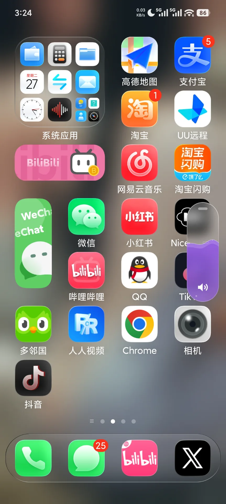

# 果汽 · 安卓音量条（Guoqi for Android）

按下音量键，冒出一杯气泡水。果汽把安卓系统自带的音量面板，换成屏幕右边缘的一枚气泡水胶囊：水位就是音量，长按连续调，上下拖动直接调，点一下汽水漫满整个屏幕。

本仓库**只发布安卓安装包（APK）**，不含源码。

> 官网和下载页：**https://forum.hanakos.cc/volume**

  
  
  

---

## 下载

| 版本 | 体积 | 系统要求 | 下载 |
| --- | --- | --- | --- |
| v1.1.0（versionCode 17） | 1.4 MB | Android 8.0 及以上 | [**前往 Releases 下载 APK**](../../releases/latest) |

- SHA-256：`24c81a03bcbbbfed215826dcfefe015d6b70f299628d5c86b5dcbb921da084da`
- 也可以在官网下载：<https://forum.hanakos.cc/volume>

安装包由作者直接分发，还没有上架应用商店。首次安装时安卓会提示「未知来源」，在提示里允许浏览器或文件管理安装即可。

### 四步装好

1. 下载安装包，用系统自带的「文件管理」找到它，点开安装。OPPO、一加、realme 一定要这样装，不然系统可能不让它开启无障碍。
2. 打开果汽，照「开启步骤」允许受限制的设置（小米上叫「允许应用获取权限」）。
3. 把果汽的省电策略改成「无限制」、打开自启动，再到无障碍里打开「果汽」。
4. 在多任务界面锁定果汽的卡片，一键清理就不会把它关掉。

各家手机的叫法不一样，果汽的「开启步骤」会按你的手机品牌换成对应的说法，做完一步打一个勾。

---

## 功能

- **水位就是音量**：在任何应用里按音量键，系统面板不再出现，屏幕右边缘滑出一枚气泡水胶囊。水位就是调完的真实音量，每调一格水面晃一下。
- **长按连续调**：按住音量键约 0.3 秒，水位开始连续涨落，起步慢、越按越快，大约 1.4 秒就能从静音调到满格。
- **上下拖动**：胶囊出现的那 2 秒里，按住它上下拖就能调音量。
- **点一下，水漫全屏**：液体在约 0.4 秒里漫满整个屏幕，身后变成毛玻璃；把手机歪一歪，水面跟着倾斜。
- **毛玻璃和八种口味**：模糊强度可调（安卓 12 及以上）。水的颜色可以固定，也可以跟着前台应用的图标、跟着壁纸，或者每次随机。
- **该让的时候让**：相机用音量键拍照、阅读器用音量键翻页，把它们加进排除名单，按键就交还给应用。来电响铃、熄屏时也交给系统。

### 费用

免费下载。青柠、天蓝、牛奶白三种口味和「固定」取色免费；樱粉、橘子、薄荷、紫罗兰、莓红五种口味，和跟着应用图标、跟着壁纸、每次随机这三种取色，¥5 一次买断，在 App 里用支付宝付款。

换手机或者重装，在「已经买过」里填付款时的订单号就能找回，一笔订单最多用在 5 台设备上。

---

## 隐私

- **只在解锁时联网**：果汽只在你点「解锁」时连接 forum.hanakos.cc 下单、查付款结果，带上的只有一个随机生成的设备码。安装包里没有统计、广告和推送组件，也不需要账号。
- **无障碍只做两件事**：接收实体音量键；知道前台是哪个应用（只看包名），好把相机这类应用排除掉。配置里声明了不读取窗口内容。
- **不要悬浮窗权限，也不要 root**：胶囊画在无障碍服务自带的悬浮窗口里。
- **卸载就清空**：只在手机本地存几项设置，卸载时一起删掉。

完整的隐私政策：<https://forum.hanakos.cc/privacy>

---

## 常见问题

**按音量键弹出来的还是系统面板？**
打开果汽，看「开启步骤」有没有红字提示，照着重做对应的那一步。小米手机上，省电策略不是「无限制」时，果汽退到后台几秒就会被冻结。

**相机按音量键拍不了照了？**
在果汽的「按 App 排除」里打开相机的开关，相机在前台时按键就交还给相机。

**安卓 17 上按音量键没反应？**
安卓 17 起，系统会忽略后台应用调音量的请求。在果汽里打开「常驻前台服务」并允许它发通知就好。

**这个仓库为什么没有源码？**
本仓库只用来分发编译好的安装包，源码不公开，保留所有权利。问题和建议可以发邮件到 nadeshiko20w@gmail.com，或者到 <https://forum.hanakos.cc> 留言。

---

## 更新日志

### v1.1.0（versionCode 17）
- 新增「全部口味」：五种口味和三种自动取色 ¥5 解锁，在 App 里付款
- 1.1 之前就装着果汽的，升级后全部口味直接解锁
- 换手机、重装可以凭订单号找回
- 最下面加了「检查新版本」
- 为了解锁加了网络权限，只在点「解锁」时用

### v1.0.0（versionCode 16）
- 第一个公开版本

---

做果汽的人也在做[萤火虫之国](https://forum.hanakos.cc)，一个二次元兴趣社区。
